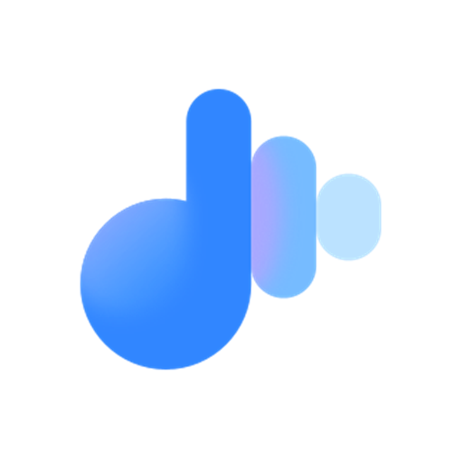
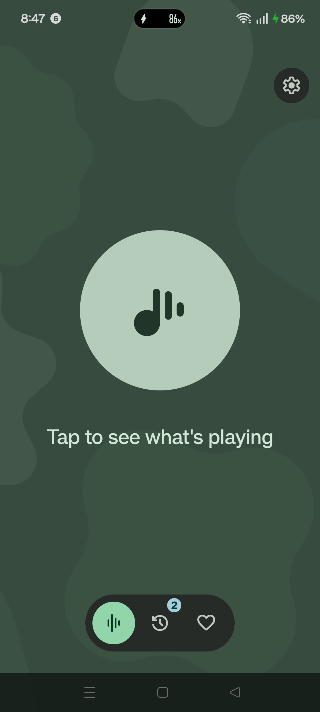
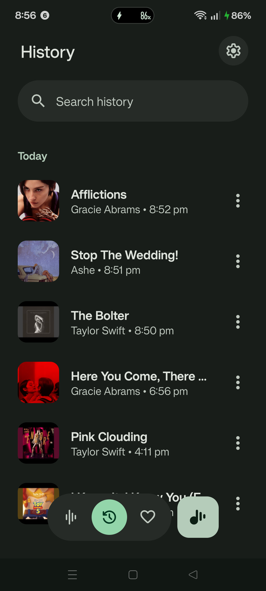
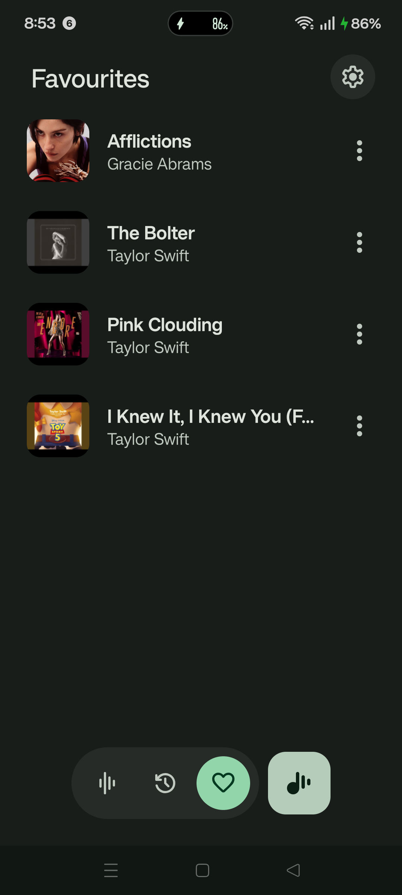

# Pixel Now Playing — 2026 Standalone App Port

### **Google Pixel's brand-new 2026 *Standalone* Now Playing app (`com.google.android.apps.pixel.nowplaying`) ported to ALL Android phones.**
**No Root. No Shizuku. No Android System Intelligence required. Just install 1 APK and go!**

  
  
  
  
  

---

> ⭐ **Working on your phone? Tap the `Star` button at the top-right!**  
> *Starring takes 1 second and helps more Android users discover this project!*

 

## ✨ Wait — How Does This Work Without Shizuku or Root?

In 2026, Google finally broke **Now Playing** out of the bloated *Android System Intelligence* system APK and released it as a **brand-new standalone Play Store app** (`com.google.android.apps.pixel.nowplaying`) with a completely redesigned **Material 3 Expressive UI**.

However, if you download the stock APK from APKMirror on a non-Pixel phone (Samsung, Xiaomi, OnePlus, Nothing, Realme, etc.):
1. It refuses to install due to Pixel-exclusive hardware flags (`PIXEL_2021_EXPERIENCE`), **or**
2. It gets stuck forever on *"Updates needed / Preparing update..."* because it tries to talk to Pixel's hidden system services.

### 💡 **How This Port Solves It (And Why It Doesn't Need Shizuku):**
- **Old Ports (*Ambient Music Mod*)** had to run a full modified *Android System Intelligence* environment and needed **Shizuku** to grant privileged `SoundTrigger` / `CAPTURE_AUDIO_HOTWORD` permissions for always-on hardware lockscreen detection.
- **This Port** is a direct port of **Google's new 2026 Standalone Now Playing app**. Instead of relying on privileged system APIs or Shizuku, it uses a **2-Tier Hybrid Recognition Engine** built right into the APK:
  1. **Tier 1 — Offline Google Neural Engine (`NNFPv3` / `libsense.so`)**: Instant on-device matching against Google's official country song shards (`music-iq-db` — auto-detects your country SIM/Locale and downloads your local top hits automatically!).
  2. **Tier 2 — Direct HTTPS Cloud Music Recognition Fallback (100M+ Global Songs)**: If a brand-new, niche, or regional song isn't in the offline database, the app automatically falls back to direct HTTPS cloud audio fingerprinting—giving you **100% song recognition coverage** with zero Shizuku or Root!

---

## 🔥 How It Compares

| Feature | 🟢 **This Port (2026 Standalone App)** | 🟡 Ambient Music Mod (Legacy ASI Port) | 🔴 Unmodified APK from APKMirror |
| :--- | :---: | :---: | :---: |
| **Base App** | **New 2026 Standalone App (`com.google.android.apps.pixel.nowplaying`)** | Legacy Android System Intelligence wrapper | New 2026 Standalone App |
| **Installation** | **Single APK Install** | Multi-app + Shizuku setup | Fails (`INSTALL_FAILED_MISSING_FEATURE`) |
| **Requires Shizuku?** | **❌ NO (Uses standard Mic permission)** | ⚠️ Yes (Required for `SoundTrigger` API) | N/A |
| **Requires Root?** | **❌ NO** | ❌ No | N/A |
| **New 2026 Material 3 Expressive UI** | **✅ YES (Official 2026 UI)** | ❌ Old UI | ✅ Yes (Pixel only) |
| **Offline + Cloud Song Recognition** | **✅ Hybrid (`NNFPv3` Offline + HTTPS Cloud 100M+ Songs)** | ✅ Yes (Requires Shizuku for Cloud) | ❌ Stuck on *"Preparing update"* |
| **Album Art + Song History + Favorites** | **✅ Full Support** | ✅ Yes | ❌ Pixel only |
| **Works on Samsung / Xiaomi / OnePlus / Nothing / Realme** | **✅ Works Out of the Box** | ⚠️ Frequently killed by OEM battery savers | ❌ Blocked by hardware check |

---

## 📸 Screenshots (Running Live on a Non-Pixel Phone!)

  <table>
    <tr>
      <td align="center"><b>🏠 2026 Expressive Home</b></td>
      <td align="center"><b>🕒 Song History & Album Art</b></td>
      <td align="center"><b>❤️ Liked / Favourites View</b></td>
    </tr>
    <tr>
      <td></td>
      <td></td>
      <td></td>
    </tr>
  </table>
  
<i>Official 2026 Google Pixel Material 3 Expressive UI recognizing songs, fetching album cover art, saving to History, and managing Favourites on a non-Pixel phone (Realme / ColorOS).</i>

---

## 📥 Download & Install (Takes 30 Seconds)

### **Step 1: Download the APK**
👉 **[Click Here to Directly Download `PixelNowPlaying_Universal_Port.apk` (v1.1.0 — 66 MB)](https://github.com/YashjitPal/Pixel-Now-Playing-Universal/releases/download/v1.1.0/PixelNowPlaying_Universal_Port.apk)**  
*(Or view the [Releases page](https://github.com/YashjitPal/Pixel-Now-Playing-Universal/releases/tag/v1.1.0))*

### **Step 2: Install & Grant Microphone Permission**
1. Open the downloaded `.apk` file and install it like any normal app.
2. Open **Now Playing** from your app drawer.
3. Tap the big **Music Note button** (and click **Allow** when it asks for Microphone access).
4. Play any song near your phone and watch it identify the track, fetch the album cover, and save it to your **History**!

---

## 💡 Features Working Right Now

- 🎨 **100% Authentic 2026 Google UI**: Expressive Lottie waveform animations, dynamic Material You Monet theming, and smooth bottom-pill navigation.
- 🧠 **2-Tier Hybrid Recognition (Offline `NNFPv3` + Online Cloud Fallback)**:
  - **Tier 1 (Offline)**: Uses Google's actual native `libsense.so` neural engine + auto-downloaded regional song databases (`US`, `IN`, `GB`, `JP`, `BR`, `DE`, `FR`, `CA`, `AU`, etc.).
  - **Tier 2 (Cloud Fallback)**: Automatically falls back to direct HTTPS cloud recognition when a song isn't in the offline database—recognizing **100+ million songs in every language**!
- 🖼️ **Automatic High-Res Album Art**: Automatically fetches cover art and metadata for recognized tracks.
- 🕒 **Full Song History & Search**: Search through every song identified around you, filter by date, or Favourite ❤️ your top tracks.
- 🎧 **One-Tap Open in Spotify / YouTube Music / Apple Music**: Connect your default music player in Settings to play any identified track immediately.

---

## ❓ Frequently Asked Questions (FAQ)

<b>1. Does this need Shizuku, Root, or a PC?</b>

 
<b>Nope!</b> Zero Root, zero Shizuku, and zero ADB commands required. You just download the APK on your phone and install it.

<b>2. Why is the APK ~66 MB when the Play Store APK is smaller?</b>

 
On a real Pixel phone, the Now Playing app relies on hidden system files and song databases pre-installed inside the Pixel ROM. We packed Google's neural audio engine (<code>libsense.so</code>) and the offline core song fingerprint database directly inside the APK so it works completely standalone on any phone!

<b>3. What Android versions and phones are supported?</b>

 
Any 64-bit (`arm64-v8a`) Android phone running <b>Android 10, 11, 12, 13, 14, 15, or 16+</b>. Tested and working on:
<ul>
  <li>Samsung Galaxy (One UI)</li>
  <li>Nothing Phone (Nothing OS)</li>
  <li>OnePlus / Oppo / Realme (OxygenOS / ColorOS / Realme UI)</li>
  <li>Xiaomi / Redmi / POCO (HyperOS / MIUI)</li>
  <li>Motorola, Vivo, Sony, Asus, and Custom ROMs</li>
</ul>

<b>4. It didn't recognize a song on the first try — what should I do?</b>

 
Make sure you granted <b>Microphone permission</b> to the app in Android Settings → Apps → Now Playing → Permissions, and hold your phone near the speaker for ~5–8 seconds while the waveform animation is active.

---

## 🛠️ For Curious Nerds: How Was This Ported?

If you just want to use the app, you don't need to read this! For developers wondering how we made it work without Root or Shizuku:
- Stripped the `com.google.android.feature.PIXEL_2017_EXPERIENCE` hardware enforcement and `com.google.android.aicore` system library lock.
- Bypassed the `Android System Intelligence (ASI)` IPC check that normally traps non-Pixel phones on the *"Updates needed / Preparing update"* screen.
- Replaced Android's privileged `MusicRecognitionManager` system service call with an in-app bridge (`StandaloneNowPlayingEngine`) that records 16kHz mono PCM audio and pipes it straight into Google's native `NnfpV3Recognizer` (`libsense.so`) and offline song database.
- Enforced 16KB ELF page alignment so native libraries load cleanly on modern Android 15/16+ kernels.

---

### ❤️ Enjoying the app?
**Don't forget to leave a ⭐ Star on this repository and share it on Reddit / XDA!**

